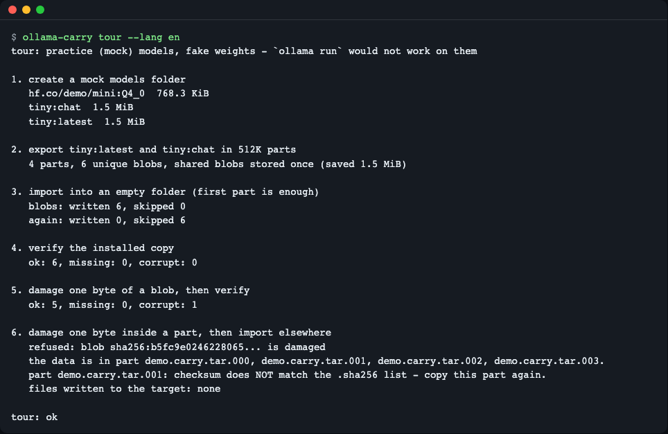
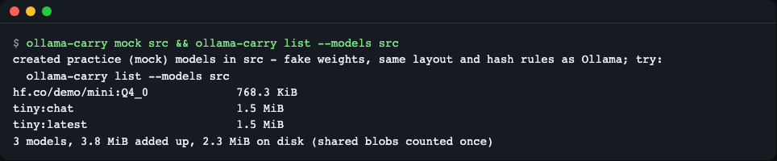
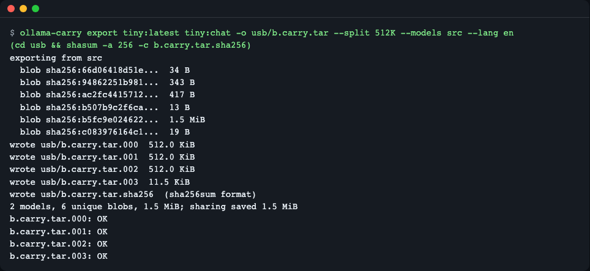
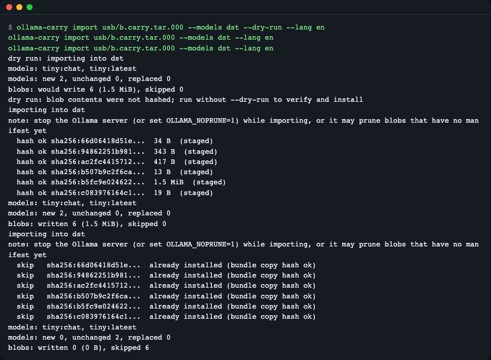
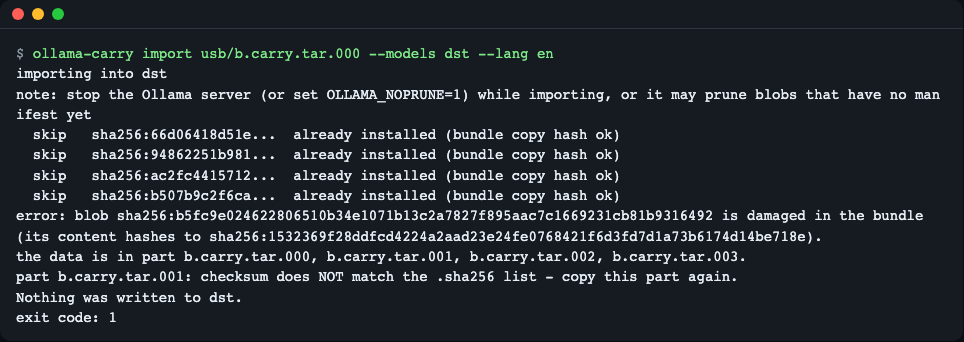
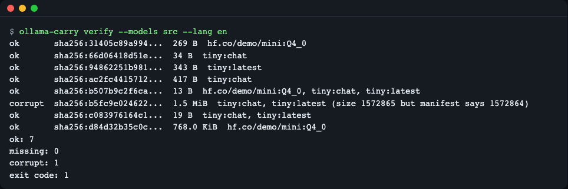
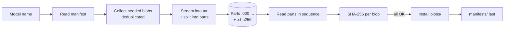

# ollama-carry

[한국어](README.md) | **English**

A single-file CLI that moves chosen Ollama models to another machine offline: it bundles the manifests and blobs (shared blobs once), splits the bundle into FAT32-sized parts, and on the other side checks every blob with SHA-256 before installing it atomically. For people who set up local LLMs on air-gapped or slow-network PCs. Build from source: `dart pub get && mkdir -p ~/.local/bin && dart compile exe bin/ollama_carry.dart -o ~/.local/bin/ollama-carry` (no release binaries yet; add `~/.local/bin` to PATH); try it with no Ollama and no network: `dart run bin/ollama_carry.dart tour`.

Instead of copying the whole model folder, this tool builds a USB-ready bundle of **only the models you pick by name**, and installs on the receiving PC **only after checking hashes**. It reduces the chore of opening manifests to find hash files by hand, the problem of files over 4GB not fitting on a FAT32 USB, and the worry of not knowing whether the copy got corrupted.


*One run of `ollama-carry tour` runs export → import → verify → tamper detection on practice data*

## Who it's for
- You need to install a local LLM on a PC with no internet (corporate network, lab, field site)
- You hand out the same model by USB to several PCs on slow connections
- A model shows up in `ollama list` but behaves strangely, and you want to check whether the files on disk are corrupted

## Installation

There is no downloadable release binary yet. Build from source. Once built, the executable can be copied to another PC and used without Dart (between the same OS and CPU type).

```bash
# Prerequisite: Dart SDK 3.8.1 or later (macOS example: brew install dart / otherwise: https://dart.dev/get-dart)
git clone https://github.com/LeeGyeongPil/ollama-carry
cd ollama-carry
dart pub get
mkdir -p "$HOME/.local/bin"
dart compile exe bin/ollama_carry.dart -o "$HOME/.local/bin/ollama-carry"
export PATH="$HOME/.local/bin:$PATH"   # To use it in new terminals too, add this to your shell config file (~/.zshrc, etc.)
ollama-carry --version
```

Running it prints `ollama-carry 0.1.2`. If you do not want to touch PATH, you can change the last line to `"$HOME/.local/bin/ollama-carry" --version` and run it by full path. On minimal Linux you only need `git` and the Dart SDK (see the link above for installing Dart). To keep the build output out of the repo, give `-o` a path outside the repo.

## Quick start

No Ollama and no internet are needed. It creates a **practice mock model** in a temporary folder, runs the whole process once, and deletes the temporary folder when done.

```bash
dart run bin/ollama_carry.dart tour
```

If the last line is `tour: ok`, all is well. The `corrupt: 1` you see in the middle means that at the step where 1 byte was deliberately damaged, **the tool caught the corruption**.

> Practice mock mode: the storage layout and hash rules are the same as real Ollama, but the weights are fake data, so `ollama run` does not work. On a real model folder it reads and hashes several GB to hundreds of GB, so it can take minutes to tens of minutes, and longer if Ollama is writing to the disk on the same PC.

## Concepts first: how Ollama stores models

Think of it as moving house.

- **Blob** = a box labelled only with a number. The weights, template and settings are each one `blobs/sha256-<64 characters>` file. The file name is the **hash (fingerprint)** of the contents, so a difference of even 1 byte changes the name.
- **Manifest** = the ledger. A `manifests/<host>/<namespace>/<model>/<tag>` file is a small JSON that records "this model is made of these boxes".
- Two tags that use the same weights **share a box**. So simply adding up model sizes comes out larger than actual disk usage (`3.8 MiB added up, 2.3 MiB on disk` in the `list` output below).

```text
models/
├── manifests/registry.ollama.ai/library/tiny/latest   ← ledger (JSON)
└── blobs/sha256-b5fc9e02…                             ← box (weights, etc.)
```

The core of the actual practice manifest (`tiny:latest`) is below. The weights, template and parameters each have their own digest and size.

```json
{"config":{"digest":"sha256:94862251…","size":343},
 "layers":[{"mediaType":"application/vnd.ollama.image.model","digest":"sha256:b5fc9e02…","size":1572864},
           {"mediaType":"application/vnd.ollama.image.template","digest":"sha256:b507b9c2…","size":13},
           {"mediaType":"application/vnd.ollama.image.params","digest":"sha256:c0839761…","size":19}]}
```

The official `ollama` has no command to "export and import a single model as a file". The same request has been open for a long time: [ollama/ollama#335](https://github.com/ollama/ollama/issues/335) (closed as not planned in 2026-04), [#17115](https://github.com/ollama/ollama/issues/17115) (open), and the implementing PR [#18578](https://github.com/ollama/ollama/pull/18578). Instead of rebuilding with `ollama create`, this tool moves the **manifests and blobs byte for byte**, so digests are preserved (checked 2026-11-10). The storage format follows Ollama's source [`server/modelpath.go`](https://cdn.jsdelivr.net/gh/ollama/ollama@0.9.0/server/modelpath.go) (as of v0.9.0, checked 2026-11-10).

## Usage

| Command | What it does | Example |
|---|---|---|
| `where` | Shows which model folder is used and why | `ollama-carry where` |
| `list` | Installed models and sizes | `ollama-carry list` |
| `export <model>... -o <file>` | Exports chosen models as a bundle. `--split 512K`, `3.9G` or `fat32` splits into parts | `ollama-carry export qwen3:8b -o /mnt/usb/q.carry.tar --split fat32` |
| `import <file or file.000>` | Installs after hash verification. `--dry-run` previews, `--force` replaces a same-named model | `ollama-carry import /mnt/usb/q.carry.tar.000` |
| `verify [<model>...]` | Checks installed blobs (`ok`/`missing`/`corrupt`), `--json` | `ollama-carry verify qwen3:8b` |
| `mock <folder>` | Creates a practice mock model folder | `ollama-carry mock src` |
| `tour` | Demonstrates the whole process above in a temporary folder | `ollama-carry tour` |

`where`, `list`, `export`, `import` and `verify` let you choose the model folder directly with `--models <folder>`. Check each command's options with `ollama-carry <command> --help` (or `-h`).

Exit codes: `0` success / `1` integrity problem (hash mismatch, missing, rejected) / `2` usage error or nonexistent model / `3` name conflict (no `--force`).

All the scenarios below are real output from running on the practice mock folder (`src`). With a real model, leave out `--models` to use the default folder.

### 1. Create a model folder and check it

```bash
ollama-carry mock src
ollama-carry list --models src
```


*3 models. Adding up sizes gives 3.8 MiB, but counting shared blobs once, it is 2.3 MiB on disk*

### 2. Sending PC: export (split into parts)

```bash
mkdir usb
ollama-carry export tiny:latest tiny:chat -o usb/b.carry.tar --split 512K --models src
(cd usb && shasum -a 256 -c b.carry.tar.sha256)
```


*6 unique blobs (weights shared by the two tags are counted once), 4 parts, and a per-part checksum list (.sha256)*

- `b.carry.tar.000` to `.003` are the parts, and `b.carry.tar.sha256` is the per-part SHA-256 list. It uses the same format as `sha256sum -c` (on macOS, `shasum -a 256 -c`), so you can check the parts after copying to USB even without this tool.
- Exporting again from the same input gives a byte-identical bundle (modification time and owner are fixed to 0).
- `--split fat32` is a size matched to FAT32's 4GB per-file limit.

### 3. Receiving PC: preview, import, import again

```bash
ollama-carry import usb/b.carry.tar.000 --models dst --dry-run
ollama-carry import usb/b.carry.tar.000 --models dst
ollama-carry import usb/b.carry.tar.000 --models dst
```


*dry-run writes nothing → the real import prints hash ok for each blob → running the same command again skips all 6*

- If you point at only the first part (`.000`), the rest are read on in name order automatically. It does not create a huge file by joining the parts.
- `--dry-run` does not hash blob contents (it only shows the number to write and the bytes needed). Real verification happens when you run without dry-run.
- Blobs already installed are skipped rather than rewritten (incremental), but the copy inside the bundle is still checked by hash, so a corrupted part is caught in this case too. Check the installed side with `verify`.
- While importing, stop the Ollama server or set `OLLAMA_NOPRUNE=1`. The server may clean up blobs that do not yet have a manifest ([FAQ](https://raw.githubusercontent.com/ollama/ollama/main/docs/faq.mdx), checked 2026-11-10).

### 4. When a part is corrupted while copying to USB

```bash
# Practice: deliberately change 1 byte of part .001 (only in the practice usb folder)
printf X | dd of=usb/b.carry.tar.001 bs=1 seek=1000 conv=notrunc
ollama-carry import usb/b.carry.tar.000 --models dst
```


*Against the already-installed `dst`, after changing 1 byte of part .001: installed blobs are skipped, the corrupted blob and a "copy this part again" notice appear, exit code 1, and 0 files newly written*

The command above is the case of importing again into the `dst` already installed in step 3. Installed blobs are skipped, but the copy inside the bundle is checked by hash, so the corrupted part is rejected in this case too and `dst` is left as it was.

Only the parts that the hash-mismatched blob spans are recomputed and compared with the `.sha256` list, so you can tell right away which part to copy again.

### 5. Check installed models

```bash
# Practice: append 1 byte to the end of a weights blob (only in the practice src; after this, export from src fails, so create a fresh mock to redo it)
ls src/blobs
printf X >> src/blobs/sha256-<full name of the weights blob>   # the 1.5 MiB one
ollama-carry verify --models src
```


*After appending 1 byte to the end of the weights blob: 1 `corrupt`, exit code 1*

In scripts, use `verify --json`. For each blob it gives `digest`, `size`, `status` and the list of referencing models, and if there is a problem it gives `"ok": false` and exit code 1.

## Configuration

| Item | Description |
|---|---|
| `--models <folder>` | Specify the model folder directly (highest priority) |
| `OLLAMA_MODELS` | An environment variable with the same meaning as in Ollama. Used when there is no `--models` |
| OS default | macOS and Windows: `~/.ollama/models`. Linux: `/usr/share/ollama/.ollama/models` if it has `manifests/` (service install), otherwise `~/.ollama/models` |

It uses no API key and no network. `ollama-carry where` prints the evidence for which folder was chosen and why (a Linux service install is owned by the `ollama` user, so `sudo` or `--models` may be needed).

## How it works



1. It reads the manifest from the model name and builds the list of needed blobs. If two models use the same blob, they are merged into one.
2. While copying blobs it computes hashes to also check whether the source is already corrupted, and stops the export if it is.
3. The bundle is a tar in the order `carry.json` (contents list) → manifests → blobs. PAX extensions are used for entries over 8GiB.
4. On import, it extracts into a temporary folder inside the model folder (`.carry-staging-<pid>`) and checks each blob's hash as it goes.
5. **Only if everything matches** are the blobs moved, and the manifest is written **last**. Even if it fails midway, no broken model shows up in `ollama list`, and on failure the temporary folder is deleted.
6. Safeguards: path traversal (`../`), absolute paths, link entries and unknown names are rejected, and if a different model with the same name exists it stops with exit code 3 (replaced only with `--force`).

## Bundle format

| File | Contents |
|---|---|
| `<name>.tar` or `<name>.tar.000`… | tar (ustar + PAX). The first entry is `carry.json` (format version, model and manifest sha256, blob digest and size) |
| `<name>.tar.sha256` | Per-part SHA-256, `sha256sum` compatible |

You can list the contents with the system `tar -tf` (for parts, `cat b.carry.tar.0* | tar -tf -`). This compatibility is cross-checked in `test/tar_test.dart` against the system `tar` and `package:archive`.

## When to use it

- It fits when: you want to move **only chosen** installed models to a PC with no network and verify them by hash, or move them **in parts** to a place with a file-size limit such as a FAT32 USB.
- On a PC that has a network, `ollama pull` may be simpler (https://github.com/ollama/ollama, checked 2026-11-10).
- If you only want to move the whole model folder once, rsync may be simpler (https://rsync.samba.org/).
- To rebuild a model from a GGUF file, see Ollama's Modelfile and `ollama create` (https://github.com/ollama/ollama, checked 2026-11-10).

## Known limitations
- Entries over 8GiB were checked only up to the header unit tests. We have not tried a real round trip of 9GB or more.
- Free disk space is not checked (`dry-run` tells you the bytes needed).
- Already-installed blobs are skipped judging by size only, and `import` does not re-hash the installed side (only the copy in the bundle is hashed). Check the installed side with `verify`.
- The mock folder has fake weights, so `ollama run` does not work.
- Not available yet: `du`, `inspect`, `list --json`, release binaries, publishing to pub.dev.

## Troubleshooting

| Symptom | Cause | Fix |
|---|---|---|
| `error: blob … is damaged in the bundle` | A part was corrupted during the USB copy or transfer | Copy the part named in the message again and check with `shasum -a 256 -c <name>.tar.sha256` |
| Exit code 3 (name conflict) | A different model with the same name is already installed | After checking the contents, use `--force` to replace it |
| `list` shows 0 models | It is looking at a different model folder | Check the folder and its basis with `ollama-carry where`, and specify `--models` or `OLLAMA_MODELS` |
| Permission error on Linux | The service install folder is owned by the `ollama` user | Run with `sudo` or check folder ownership (you can specify another folder with `--models`) |
| The file will not fit on a FAT32 USB | A single file is over 4GB | `export … --split fat32` |
| It does not show in `ollama list` after importing | The Ollama server uses a different model folder | Make the folder the server uses (`OLLAMA_MODELS`) and `--models` the same |

## Development and contributing

```bash
dart pub get
dart analyze
dart format --output=none --set-exit-if-changed .
dart test
```

All tests run on mock models in temporary folders and need neither Ollama nor a network. CI (GitHub Actions) runs the same checks on ubuntu, macos and windows. Please leave bugs and suggestions as issues. The change log is [CHANGELOG.md](CHANGELOG.md) (Korean); for security matters see [SECURITY.md](SECURITY.md).

## License
MIT. It includes no external models or data (the practice weights are pseudo-random values produced by the code).
