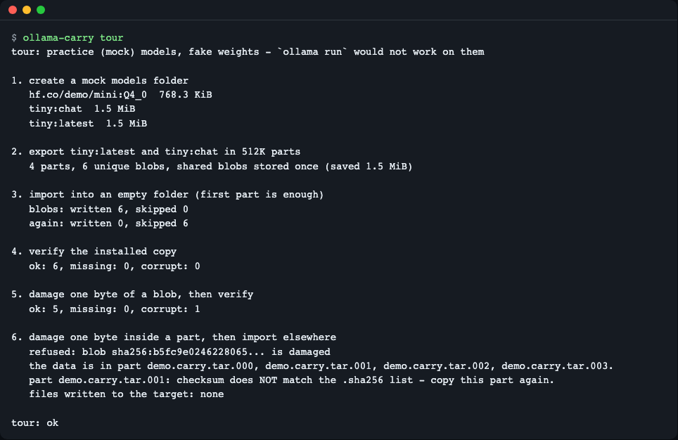
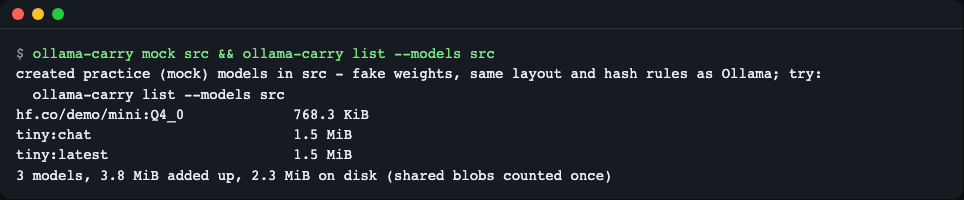
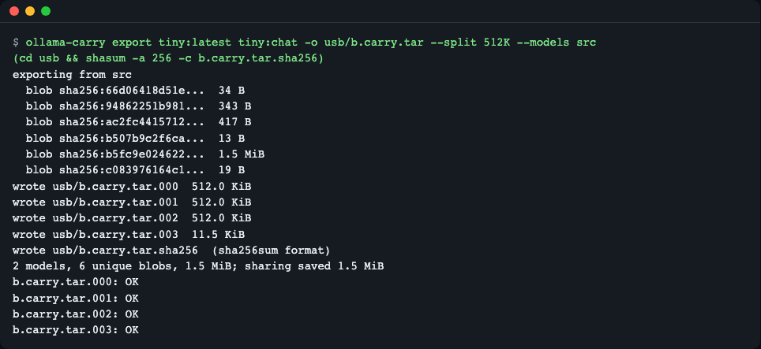
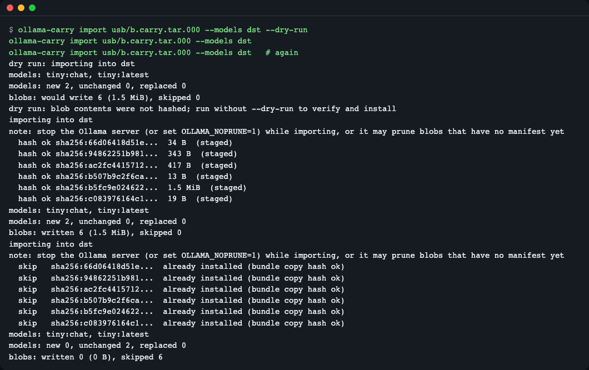
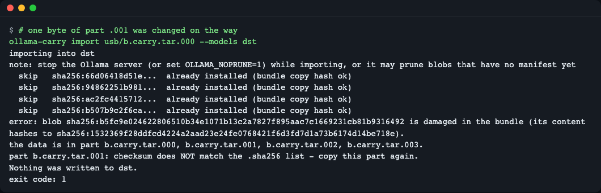
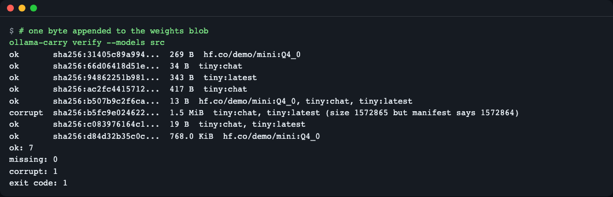

# ollama-carry

> **English summary** — A single-file CLI that moves chosen Ollama models to another machine offline: it bundles the manifests and blobs (shared blobs once), splits the bundle into FAT32-sized parts, and on the other side checks every blob with SHA-256 before installing it atomically. For people who set up local LLMs on air-gapped or slow-network PCs. Build from source: `dart pub get && mkdir -p ~/.local/bin && dart compile exe bin/ollama_carry.dart -o ~/.local/bin/ollama-carry` (no release binaries yet; add `~/.local/bin` to PATH); try it with no Ollama and no network: `dart run bin/ollama_carry.dart tour`.

모델 폴더를 통째로 복사하지 않고, **이름으로 고른 모델만** USB 용 묶음으로 만들고, 받는 PC 에서 **해시로 확인한 뒤에만** 설치하는 도구입니다. 매니페스트를 열어 해시 파일을 손으로 찾는 일, 4GB 넘는 파일이 FAT32 USB 에 안 들어가는 문제, 복사가 깨졌는지 모르는 불안을 줄입니다.


*`ollama-carry tour` 한 번으로 내보내기 → 가져오기 → 점검 → 변조 탐지까지 연습용 데이터로 돌려 본 화면*

## 이런 분께
- 인터넷이 막힌 PC(사내망·연구실·현장)에 로컬 LLM 을 설치해야 하는 분
- 같은 모델을 느린 회선의 여러 PC 에 USB 로 나눠 주는 분
- 모델이 `ollama list` 에는 보이는데 실행이 이상해서, 디스크의 파일이 깨졌는지 확인하고 싶은 분

## 설치

아직 내려받을 수 있는 릴리스 바이너리는 없습니다. 소스에서 빌드합니다. 한 번 만든 실행 파일은 Dart 없이 다른 PC 에 복사해서 쓸 수 있습니다(같은 OS·CPU 종류끼리).

```bash
# 전제: Dart SDK 3.8.1 이상 (macOS 예: brew install dart / 그 밖: https://dart.dev/get-dart)
git clone https://github.com/LeeGyeongPil/ollama-carry
cd ollama-carry
dart pub get
mkdir -p "$HOME/.local/bin"
dart compile exe bin/ollama_carry.dart -o "$HOME/.local/bin/ollama-carry"
export PATH="$HOME/.local/bin:$PATH"   # 새 터미널에서도 쓰려면 셸 설정 파일(~/.zshrc 등)에 추가
ollama-carry --version
```

실행하면 `ollama-carry 0.1.0` 이 나옵니다. PATH 를 건드리기 싫다면 마지막 줄을 `"$HOME/.local/bin/ollama-carry" --version` 으로 바꿔 전체 경로로 실행해도 됩니다. 최소 리눅스에서는 `git` 과 Dart SDK 만 있으면 됩니다(Dart 설치 방법은 위 링크). 빌드 결과를 레포 안에 두지 않도록 `-o` 로 레포 밖 경로를 지정하세요.

## 빠르게 시작하기

Ollama 도, 인터넷도 필요 없습니다. 임시 폴더에 **연습용 목(mock) 모델**을 만들어 전 과정을 한 번 돌리고, 끝나면 임시 폴더를 지웁니다.

```bash
dart run bin/ollama_carry.dart tour
```

마지막 줄이 `tour: ok` 면 정상입니다. 중간에 보이는 `corrupt: 1` 은 일부러 1바이트를 망가뜨린 단계에서 **도구가 깨진 것을 잡았다**는 뜻입니다.

> 연습용 목(mock) 모드: 저장 구조·해시 규칙은 실제 Ollama 와 같지만 가중치는 가짜 데이터라 `ollama run` 은 되지 않습니다. 실제 모델 폴더에서는 수 GB~수백 GB 를 읽고 해시하므로 몇 분~수십 분 걸릴 수 있고, 같은 PC 에서 Ollama 가 디스크를 쓰고 있으면 더 느립니다.

## 개념 먼저: Ollama 는 모델을 이렇게 저장합니다

이삿짐에 비유하면 이렇습니다.

- **블롭(blob)** = 번호만 적힌 상자. 가중치·템플릿·설정이 각각 `blobs/sha256-<64자리>` 파일 하나입니다. 파일 이름이 곧 내용의 **해시(지문)** 라서, 1바이트만 달라도 이름이 달라집니다.
- **매니페스트(manifest)** = 장부. `manifests/<호스트>/<네임스페이스>/<모델>/<태그>` 파일이 "이 모델은 어떤 상자들로 이뤄졌다"를 적은 작은 JSON 입니다.
- 같은 가중치를 쓰는 두 태그는 **상자를 공유**합니다. 그래서 모델 크기를 단순히 더하면 실제 디스크 사용량보다 큽니다(아래 `list` 의 `3.8 MiB added up, 2.3 MiB on disk`).

```text
models/
├── manifests/registry.ollama.ai/library/tiny/latest   ← 장부(JSON)
└── blobs/sha256-b5fc9e02…                             ← 상자(가중치 등)
```

실제 연습용 매니페스트(`tiny:latest`)의 핵심은 아래와 같습니다. 가중치·템플릿·파라미터가 각자 digest 와 size 를 가집니다.

```json
{"config":{"digest":"sha256:94862251…","size":343},
 "layers":[{"mediaType":"application/vnd.ollama.image.model","digest":"sha256:b5fc9e02…","size":1572864},
           {"mediaType":"application/vnd.ollama.image.template","digest":"sha256:b507b9c2…","size":13},
           {"mediaType":"application/vnd.ollama.image.params","digest":"sha256:c0839761…","size":19}]}
```

공식 `ollama` 에는 "모델 하나를 파일로 내보내고 가져오는" 명령이 없습니다. 같은 요청이 오래 열려 있습니다: [ollama/ollama#335](https://github.com/ollama/ollama/issues/335)(2026-04 에 not planned 로 닫힘), [#17115](https://github.com/ollama/ollama/issues/17115)(열림), 구현 PR [#18578](https://github.com/ollama/ollama/pull/18578). 이 도구는 `ollama create` 로 다시 만드는 대신 **매니페스트·블롭을 바이트 그대로** 옮겨 digest 가 보존됩니다(2026-11-10 확인). 저장 형식은 Ollama 소스의 [`server/modelpath.go`](https://cdn.jsdelivr.net/gh/ollama/ollama@0.9.0/server/modelpath.go)(v0.9.0 기준, 확인 2026-11-10)를 따릅니다.

## 사용법

| 명령 | 하는 일 | 예 |
|---|---|---|
| `where` | 어떤 모델 폴더를 왜 쓰는지 보여 줌 | `ollama-carry where` |
| `list` | 설치된 모델과 크기 | `ollama-carry list` |
| `export <모델>... -o <파일>` | 고른 모델을 묶음으로 내보냄. `--split 512K`·`3.9G`·`fat32` 로 조각 분할 | `ollama-carry export qwen3:8b -o /mnt/usb/q.carry.tar --split fat32` |
| `import <파일 또는 파일.000>` | 해시 검증 후 설치. `--dry-run` 미리 보기, `--force` 같은 이름 교체 | `ollama-carry import /mnt/usb/q.carry.tar.000` |
| `verify [<모델>...]` | 설치된 블롭 점검(`ok`/`missing`/`corrupt`), `--json` | `ollama-carry verify qwen3:8b` |
| `mock <폴더>` | 연습용 목(mock) 모델 폴더 생성 | `ollama-carry mock src` |
| `tour` | 위 전 과정을 임시 폴더에서 시연 | `ollama-carry tour` |

`where`·`list`·`export`·`import`·`verify` 는 `--models <폴더>` 로 모델 폴더를 직접 고를 수 있습니다.

종료 코드: `0` 성공 / `1` 무결성 문제(해시 불일치·누락·거부) / `2` 사용법 오류·없는 모델 / `3` 이름 충돌(`--force` 없음).

아래 시나리오는 모두 연습용 목 폴더(`src`)로 실행한 실제 출력입니다. 실제 모델에서는 `--models` 를 빼면 기본 폴더를 씁니다.

### 1. 모델 폴더 만들고 확인하기

```bash
ollama-carry mock src
ollama-carry list --models src
```


*모델 3개. 크기를 더하면 3.8 MiB 지만 공유 블롭을 한 번만 세면 디스크에는 2.3 MiB*

### 2. 보내는 PC: 내보내기(조각 분할)

```bash
mkdir usb
ollama-carry export tiny:latest tiny:chat -o usb/b.carry.tar --split 512K --models src
(cd usb && shasum -a 256 -c b.carry.tar.sha256)
```


*고유 블롭 6개(두 태그가 공유하는 가중치는 한 번만), 조각 4개, 조각별 체크섬 목록(.sha256)*

- `b.carry.tar.000`~`.003` 이 조각, `b.carry.tar.sha256` 이 조각별 SHA-256 목록입니다. `sha256sum -c`(macOS 는 `shasum -a 256 -c`)와 같은 형식이라 이 도구 없이도 USB 복사 후 조각을 확인할 수 있습니다.
- 같은 입력으로 다시 내보내면 바이트까지 같은 묶음이 나옵니다(수정 시각·소유자를 0 으로 고정).
- `--split fat32` 는 FAT32 의 파일 하나 4GB 제한에 맞춘 크기입니다.

### 3. 받는 PC: 미리 보기, 가져오기, 다시 가져오기

```bash
ollama-carry import usb/b.carry.tar.000 --models dst --dry-run
ollama-carry import usb/b.carry.tar.000 --models dst
ollama-carry import usb/b.carry.tar.000 --models dst
```


*dry-run 은 아무것도 쓰지 않음 → 실제 import 는 블롭마다 hash ok → 같은 명령을 또 실행하면 6개 모두 skip*

- 첫 조각(`.000`)만 가리키면 나머지는 이름 순서대로 자동으로 이어 읽습니다. 조각을 합친 거대한 파일을 만들지 않습니다.
- `--dry-run` 은 블롭 내용을 해시하지 않습니다(쓸 개수와 필요한 바이트만 보여 줌). 진짜 검증은 dry-run 없이 실행할 때 일어납니다.
- 이미 설치된 블롭은 다시 쓰지 않고 건너뛰지만(증분), 묶음 안의 사본은 그래도 해시로 확인하므로 깨진 조각은 이 경우에도 잡힙니다. 설치된 쪽 점검은 `verify` 로 하세요.
- 가져오는 동안에는 Ollama 서버를 끄거나 `OLLAMA_NOPRUNE=1` 로 두세요. 매니페스트가 아직 없는 블롭을 서버가 정리할 수 있습니다([FAQ](https://raw.githubusercontent.com/ollama/ollama/main/docs/faq.mdx), 2026-11-10 확인).

### 4. USB 복사 중 조각이 깨졌을 때

```bash
# 연습: 조각 .001 의 1바이트를 일부러 바꿉니다(연습용 usb 폴더에서만)
printf X | dd of=usb/b.carry.tar.001 bs=1 seek=1000 conv=notrunc
ollama-carry import usb/b.carry.tar.000 --models dst
```


*이미 설치된 `dst` 에 대해 조각 .001 의 1바이트를 바꾼 뒤: 설치된 블롭은 skip, 깨진 블롭과 "이 조각을 다시 복사" 안내, 종료 코드 1, 새로 쓴 파일 0개*

위 명령은 3번에서 이미 설치된 `dst` 에 다시 가져오는 경우입니다. 이미 설치된 블롭은 건너뛰지만 묶음 안의 사본은 해시로 확인하므로, 깨진 조각은 이 경우에도 거부되고 `dst` 는 그대로입니다.

해시가 안 맞는 블롭이 걸친 조각만 다시 계산해 `.sha256` 목록과 비교하므로, 어느 조각을 다시 복사할지 바로 알 수 있습니다.

### 5. 설치된 모델 점검

```bash
# 연습: 가중치 블롭 끝에 1바이트 덧붙이기(연습용 src 에서만; 이후 src 의 export 는 실패하니 다시 하려면 mock 을 새로 만드세요)
ls src/blobs
printf X >> src/blobs/sha256-<가중치 블롭 전체 이름>   # 1.5 MiB 짜리
ollama-carry verify --models src
```


*가중치 블롭 끝에 1바이트를 덧붙인 뒤: `corrupt` 1건, 종료 코드 1*

스크립트에서는 `verify --json` 을 쓰세요. 블롭마다 `digest`·`size`·`status`·참조 모델 목록이 나오고, 문제가 있으면 `"ok": false` 와 종료 코드 1 입니다.

## 설정

| 항목 | 설명 |
|---|---|
| `--models <폴더>` | 모델 폴더를 직접 지정(가장 우선) |
| `OLLAMA_MODELS` | Ollama 와 같은 의미의 환경변수. `--models` 가 없을 때 사용 |
| OS 기본 | macOS·Windows `~/.ollama/models`. Linux 는 `/usr/share/ollama/.ollama/models` 에 `manifests/` 가 있으면 그쪽(서비스 설치), 아니면 `~/.ollama/models` |

API 키·네트워크는 쓰지 않습니다. `ollama-carry where` 가 어떤 폴더를 왜 골랐는지 근거를 출력합니다(Linux 서비스 설치는 `ollama` 사용자 소유라 `sudo` 나 `--models` 가 필요할 수 있습니다).

## 동작 원리


1. 모델 이름으로 매니페스트를 읽고, 필요한 블롭 목록을 만듭니다. 두 모델이 같은 블롭을 쓰면 하나로 합칩니다.
2. 블롭을 복사하면서 해시를 계산해 원본이 이미 깨졌는지도 확인하고, 깨졌으면 내보내기를 멈춥니다.
3. 묶음은 `carry.json`(내용 목록) → 매니페스트 → 블롭 순서의 tar 입니다. 8GiB 넘는 항목을 위해 PAX 확장을 씁니다.
4. 가져올 때는 모델 폴더 안 임시 폴더(`.carry-staging-<pid>`)에 풀면서 블롭마다 해시를 확인합니다.
5. **전부 맞을 때만** 블롭을 옮기고, 매니페스트는 **마지막에** 씁니다. 중간에 실패해도 `ollama list` 에 깨진 모델이 보이지 않고, 실패하면 임시 폴더를 지웁니다.
6. 안전장치: 경로 탐색(`../`)·절대 경로·링크 항목·모르는 이름은 거부하고, 같은 이름의 다른 모델이 있으면 종료 코드 3 으로 멈춥니다(`--force` 로만 교체).

## 묶음 형식

| 파일 | 내용 |
|---|---|
| `<이름>.tar` 또는 `<이름>.tar.000`… | tar(ustar + PAX). 첫 항목이 `carry.json`(형식 버전, 모델·매니페스트 sha256, 블롭 digest·size) |
| `<이름>.tar.sha256` | 조각별 SHA-256, `sha256sum` 호환 |

시스템 `tar -tf` 로 목록을 볼 수 있습니다(조각은 `cat b.carry.tar.0* | tar -tf -`). 이 호환은 `test/tar_test.dart` 에서 시스템 `tar` 와 `package:archive` 로 교차 확인합니다.

## 다른 도구와 비교

| | ollama-carry | 폴더 통째 복사(rsync·robocopy) | GGUF + `ollama create` | sammcj/gollama |
|---|---|---|---|---|
| 고른 모델만 | O | X(전체 또는 손으로 digest 찾기) | O | 목록·삭제 중심 |
| 공유 블롭 한 번만 | O | 손으로 | 해당 없음 | 해당 없음 |
| FAT32 용 조각 분할 | O | X | X | X |
| 블롭·조각 해시 검증 | O | X(복사 도구 기본은 없음) | X | X |
| digest 보존 | O(바이트 그대로) | O | X(다시 만들면 달라질 수 있음) | 해당 없음 |
| 받는 PC 에 필요한 것 | 실행 파일 하나 | 파일 복사 도구 | Ollama 서버 실행 중 | Go TUI |

레지스트리에서 직접 내려받는 도구(예: ollama-dl 류)는 네트워크가 있는 쪽에서 유용하고, 이 도구는 이미 받은 모델을 **옮기고 검증**하는 데 집중합니다. 폴더 전체를 한 번 옮기는 것뿐이라면 rsync 가 더 간단합니다.

## 알려진 한계
- 8GiB 넘는 항목은 헤더 단위 테스트까지만 확인했습니다. 실제 9GB 이상 왕복은 직접 해 보지 않았습니다.
- 남은 디스크 용량은 확인하지 않습니다(`dry-run` 이 필요한 바이트만 알려 줍니다).
- 이미 설치된 블롭은 크기만 보고 건너뛰고, 설치된 쪽 내용은 `import` 가 다시 해시하지 않습니다(묶음 쪽 사본만 해시). 설치된 쪽은 `verify` 로 점검하세요.
- 목 폴더는 가짜 가중치라 `ollama run` 이 되지 않습니다.
- 아직 없음: `du`, `inspect`, `list --json`, 릴리스 바이너리, pub.dev 게시.

## 자주 겪는 문제

| 증상 | 원인 | 해결 |
|---|---|---|
| `error: blob … is damaged in the bundle` | USB 복사·전송 중 조각이 깨짐 | 메시지에 나온 조각을 다시 복사하고 `shasum -a 256 -c <이름>.tar.sha256` 로 확인 |
| 종료 코드 3(이름 충돌) | 같은 이름의 다른 모델이 이미 설치됨 | 내용을 확인한 뒤 교체하려면 `--force` |
| `list` 가 모델 0개 | 다른 모델 폴더를 보고 있음 | `ollama-carry where` 로 폴더와 근거 확인, `--models`·`OLLAMA_MODELS` 지정 |
| Linux 에서 권한 오류 | 서비스 설치 폴더가 `ollama` 사용자 소유 | `sudo` 로 실행하거나 폴더 소유권 확인(`--models` 로 다른 폴더 지정 가능) |
| FAT32 USB 에 파일이 안 들어감 | 파일 하나가 4GB 초과 | `export … --split fat32` |
| 가져온 뒤 `ollama list` 에 안 보임 | Ollama 서버가 다른 모델 폴더를 씀 | 서버가 쓰는 폴더(`OLLAMA_MODELS`)와 `--models` 를 같게 |

## 개발·기여

```bash
dart pub get
dart analyze
dart format --output=none --set-exit-if-changed .
dart test
```

테스트는 모두 임시 폴더의 목 모델로 동작하며 Ollama·네트워크가 필요 없습니다. CI(GitHub Actions)는 ubuntu·macos·windows 에서 같은 검사를 돌립니다. 버그·제안은 이슈로 남겨 주세요. 변경 기록은 [CHANGELOG.md](CHANGELOG.md), 보안 관련은 [SECURITY.md](SECURITY.md).

## 라이선스
MIT. 외부 모델·데이터를 포함하지 않습니다(연습용 가중치는 코드가 생성한 의사난수).
